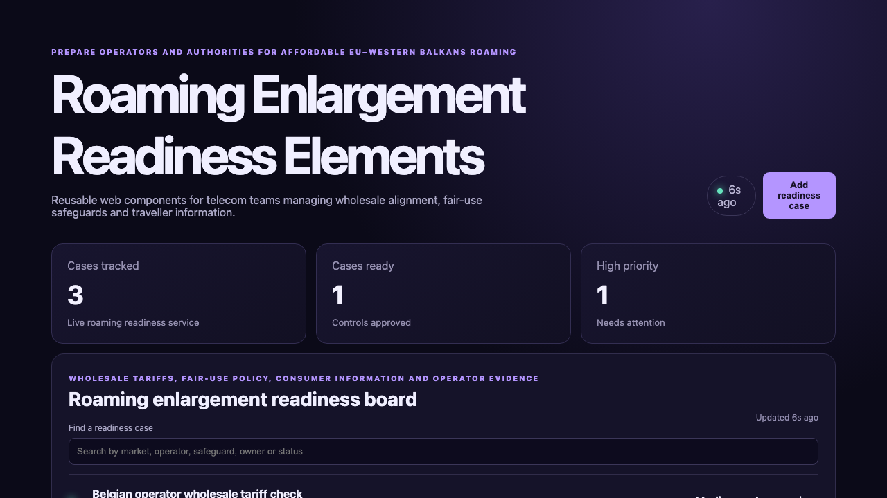

# Roaming Enlargement Readiness Elements

## One-sentence benefit
Helps telecom authorities and operators prepare fair, affordable EU–Western Balkans roaming with reusable web components.

## Live demo
Run both layers locally, then follow [the verified application demo](docs/demo.webm).

## Screenshots

## Main features
Search and sort readiness cases, create a regional pilot, advance work and inspect fair-use and tariff priorities.

## Technology used
Lit, TypeScript, native Web Components, Vite, Spring Boot and Java.

## Installation instructions
Start `cd backend && mvn spring-boot:run`, then run `npm install && npm run dev` in another terminal.

## Commercial licensing/contact
Commercial licensing and implementation support are available through the repository owner.

## Business problem and users
Telecom regulators, operators and consumer teams need a shared view of wholesale tariffs, safeguards and traveller communications.

## Key workflows
Filter fair-use cases, create a Benelux–Western Balkans pilot and move a real backend record through review.

## Lit and Web Components highlights
A typed custom element, reactive state, keyed repeat rendering, a controller and reusable status cards are demonstrated.

## Java backend highlights
Spring Boot provides real list, search, create and update endpoints, validation, clear errors, health reporting and tests.

## Architecture and state flow
The custom element fetches authoritative Java records and re-renders when reactive state changes.

## Accessibility and responsive behaviour
Semantic headings, labelled search, visible status text, strong contrast and responsive component layouts support varied devices.

## Verification commands
Use `npm test`, `npm run build`, and `cd backend && mvn test package`.

## Structure
`src` contains Lit components, `backend` contains Java, and `docs` contains verified media.

## Tradeoffs
The in-memory store keeps setup simple; production would add operator identity, tariff feeds and durable evidence.

## Roadmap
Add multilingual traveller notices, tariff simulations, operator attestations, deadline alerts and market dashboards.
